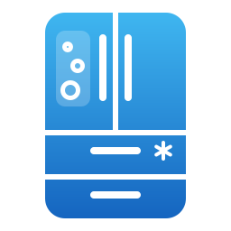

# Dreame Fridge for Home Assistant

Unofficial Home Assistant integration for Dreame refrigerators that are bound to a
**Dreamehome** app account. Developed and tested with the **Dreame Fizz Fresh (DRF560,
model `dreame.fridge.g2509`)**.

The fridge has no local API, so the integration talks to the Dreamehome cloud the same way
the app does: values are polled every 60 s and changes (doors, warnings, settings) are pushed
instantly via the cloud's MQTT broker.

> Not affiliated with or endorsed by Dreame. Use at your own risk.

## Installation (HACS)

1. HACS → ⋮ → *Custom repositories* → add `https://github.com/Thyolin/ha-dreame-fridge`, type **Integration**.
2. Install **Dreame Fridge** and restart Home Assistant.
3. *Settings → Devices & services → Add integration → Dreame Fridge*.
4. Log in with your Dreamehome e-mail and password and choose the server region
   (Europe = `eu`). If the account has several fridges you can pick one.

Manual installation: copy `custom_components/dreame_fridge` into your `config/custom_components` folder.

## Entities

| Platform | Entities |
|---|---|
| Number | Fridge temperature (2 … 8 °C), freezer temperature (−23 … −15 °C) |
| Select | Mode (manual, SuperCool, SuperFreeze, vacation, SuperCool + SuperFreeze), flex zone (fruit & vegetables, drinks, soft freeze), night view brightness |
| Switch | Ice cubes, crushed ice, sparkling water, Always Fresh, Autofill, Night View |
| Binary sensor | Fridge door, freezer door, ice bins full, CO₂ low, water tank low, problem, quiet time, sabbath mode, cloud connection |
| Sensor | Error code, last still / sparkling water dispense (seconds), carbonation cycles |

Only values and ranges the official app itself writes can be changed. The target temperatures
are set points; the fridge does not report measured temperatures.

Not available through the cloud: carbonation level and pre-mixing, which can only be set on
the fridge's control panel, and remote carbonation.

## Privacy & security

* Your e-mail and password are stored only in Home Assistant's config entry. Diagnostics
  redact them, as well as device ID and MAC address.
* The repository contains no personal credentials. `const.py` holds the public identifiers
  of the Dreamehome *app* (client ID, request-signing key), which ship identically in every
  copy of the app and are needed to talk to the cloud.
* MQTT is TLS-encrypted and only Dreame's IoT root certificate (`dreame_iot_ca.pem`) is
  trusted for it.

## Icon

The integration ships its own icon (`brand/`), shown by Home Assistant 2026.3 and newer.
Source: `assets/icon.svg`. It is an original drawing, not the Dreame logo.

## Troubleshooting

```yaml
logger:
  logs:
    custom_components.dreame_fridge: debug
```

## Deutsch (kurz)

Inoffizielle Integration für Dreame-Kühlschränke im Dreamehome-Konto (getestet: Fizz Fresh
DRF560). Über HACS als *Custom repository* hinzufügen, installieren, neu starten, dann
„Dreame Fridge“ hinzufügen und mit dem Dreamehome-Konto anmelden (Region `eu`).
Oberfläche und Entitäten gibt es auf Deutsch und Englisch.

## License

MIT – see [LICENSE](LICENSE). Independent implementation, no code from other projects.
